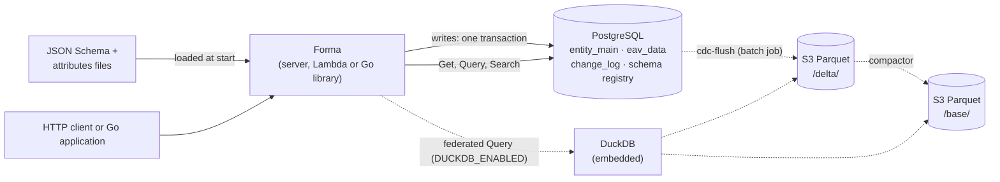

# Forma

[](https://github.com/Lychee-Technology/forma/actions/workflows/ci.yml)
[](https://codecov.io/gh/Lychee-Technology/forma)
[](go.mod)
[](LICENSE)

**Store and query entities whose shape changes often, on PostgreSQL, without writing DDL migrations.**

Forma is a data management service and Go library. You describe each entity type
with a JSON Schema file; Forma validates writes against it and stores the data in
PostgreSQL in a fixed set of tables: frequently used attributes in typed, indexable
columns of a main table, everything else in an entity-attribute-value (EAV) table.
Adding or removing an attribute is a schema-file change, not an `ALTER TABLE`.
An optional analytical tier exports the data to Parquet on S3 and answers queries
with DuckDB, merging in the rows PostgreSQL has not exported yet.

Forma is pre-1.0 (latest tag `v0.2.0`). PostgreSQL 16 is the supported database;
Aurora DSQL support is implemented but has not yet run against a real cluster
([details](#database-compatibility)).

- [Why Forma?](#why-forma)
- [Key features](#key-features)
- [Quick Start](#quick-start)
- [How it works](#how-it-works)
- [HTTP API](#http-api)
- [Consistency and compatibility](#consistency-and-compatibility)
- [Configuration](#configuration)
- [Development and testing](#development-and-testing)
- [Documentation](#documentation)
- [Contributing, support and license](#contributing)

## Why Forma?

A conventional relational schema gives you types, constraints and indexes, but every
new field is a migration. A document or schema-less store makes new fields free but
gives up declared types and validation. Forma sits between the two:

| | Conventional tables | Forma |
|---|---|---|
| Add an attribute | `ALTER TABLE` migration | Edit the JSON Schema, record it with `apply-schema`, restart |
| Validation | Column types and constraints | JSON Schema validation of writes, plus declared value types |
| Indexed access | Any column | Attributes bound to typed main-table columns; EAV attributes are not indexable |
| Analytics | A separate pipeline | Optional CDC export to Parquet, queried through DuckDB |

The costs are real. EAV reads are more complex than reading one row, so Forma
generates CTE + `JSON_AGG` SQL that fetches a page of entities and their attributes
in one statement instead of one query per entity. The main table has a fixed set
of typed columns, so only some attributes can be column-bound and indexed. And
schema changes are not free-form: changing an existing attribute's type is allowed
only when it is lossless for stored data, and refused otherwise
([Schema Evolution](docs/schema-evolution.md)).

Forma fits when:

- **Entity shapes change often.** The bundled sample schemas (`cmd/server/schemas/`)
  model a CRM — leads, contacts, visits, activities — whose fields grow over time.
- **A Go service needs multi-entity transactional workflows.** `Transactor.InTx`
  runs reads and writes across schemas in one PostgreSQL transaction, with
  preconditions, upserts on unique keys, and `Tx.Claim` for work-queue style
  consumers ([Transactions](docs/transactions.md), [Claims](docs/claims.md)).
- **The same entities need analytical scans** without a separate ETL pipeline,
  through the optional CDC + Parquet + DuckDB tier described below.

Forma is not a replacement for a general-purpose relational database or a data
warehouse: callers use its entity API rather than SQL, queries filter one schema at
a time (search spans several), and offset pagination is capped at a configurable depth.

## Key features

- **JSON Schema data modeling.** Each schema is a JSON Schema file plus a generated
  `<schema>_attributes.json` that assigns attribute IDs, value types and, optionally,
  a main-table column. A create that violates the schema answers `400` naming the
  attribute. An update that violates it is logged and written unless
  `VALIDATE_UPDATES_STRICT` is set, so rows stored before enforcement stay updatable
  ([Error Handling](docs/error-handling.md)).
- **Hybrid storage.** Column-bound attributes live in typed columns of `entity_main`;
  the rest live in `eav_data`. Column-bound attributes can carry declared composite
  indexes ([`x-forma-indexes`](docs/schema-indexes.md)) and unique keys
  ([`x-forma-unique-keys`](docs/unique-keys.md)).
- **Schema evolution without DDL.** Adding, removing and renaming attributes, safe
  widenings, and promoting an EAV attribute to a column are recorded as a new schema
  generation. Narrowing or cross-type changes are refused; explicit data migrations
  are not implemented yet (#730) ([Schema Evolution](docs/schema-evolution.md)).
- **CRUD, batches and queries.** Create, read, update, delete and atomic batches over
  HTTP or Go; paginated queries with a [condition DSL](docs/condition-dsl.md)
  (comparisons, `in`, `contains`, null tests, `and`/`or`); cross-schema text search.
- **Transactions (Go API).** `Transactor.InTx`, row fences, conditional writes
  ([Conditional Writes](docs/conditional-writes.md)), predicate updates/deletes and
  claims. There is no HTTP transaction endpoint (deferred to #656).
- **CDC to Parquet and federated queries (optional).** `cdc-flush` exports changed
  rows to S3 Parquet, `compactor` merges them into base files, and on a server that
  enables DuckDB a query can be answered by DuckDB over Parquet merged with unexported
  PostgreSQL rows. Off by default; see [limitations](#federated-queries).
- **Deployment entry points.** An HTTP server (`cmd/server`), an AWS Lambda handler
  for API Gateway HTTP APIs (`cmd/lambda`), an operations CLI (`cmd/tools`), and the
  Go packages `forma` and `factory` for embedding.

## Quick Start

This runs Forma against a local PostgreSQL 16 with the bundled sample schemas, then
creates and reads one record. It needs no S3, DuckDB setup, or cloud account.

**Prerequisites**

- Go 1.26+ and a C toolchain (the server links DuckDB through CGO). The Makefile pins
  `GOTOOLCHAIN=go1.26.0+auto`, so a newer local Go downloads go1.26.0 once.
- Docker or Podman with Docker Compose.
- `curl`.

### Option A: one script

```bash
git clone https://github.com/Lychee-Technology/forma.git
cd forma
./scripts/local_server.sh
```

The script starts the Compose stack, rebuilds the binaries (`make clean build-all`),
runs `init-db`, brings the schema generation ledger in step with `cmd/server/schemas`
(`baseline-schema`, `apply-schema`), and runs the server on `:8080` in the
foreground. `Ctrl-C` stops the server and the containers; the PostgreSQL data stays
in `deploy/data/`.

### Option B: step by step

```bash
git clone https://github.com/Lychee-Technology/forma.git
cd forma

# PostgreSQL 16 on :5432 (postgres/postgres) and RustFS, an S3-compatible
# store on :9000 that only the optional CDC/federated tier uses.
docker compose -f deploy/docker-compose.yml up -d --wait

make build-all

# Create the tables and register the sample schemas. The table names match
# the server's defaults; init-db's own defaults differ.
./build/tools init-db \
  --db-host localhost --db-port 5432 --db-name forma \
  --db-user postgres --db-password postgres --db-ssl-mode disable \
  --schema-table schema_registry_dev \
  --eav-table eav_data_dev \
  --entity-main-table entity_main_dev \
  --change-log-table change_log_dev \
  --schema-dir cmd/server/schemas

DB_PASSWORD=postgres SCHEMA_DIR=cmd/server/schemas ./build/server
```

`init-db` on a database it already initialized is safe to rerun. After you edit a
schema file, record the change with `./build/tools apply-schema` (same connection
flags plus `--schema-table` and `--schema-dir`) before restarting the server, which
refuses to start on a declaration the database has not recorded. `local_server.sh`
does this on every run.

### First request

In another terminal, check the server and create a `contact`
(`cmd/server/schemas/contact.json` requires `id` and `email`):

```bash
curl -s localhost:8080/health
# {"status":"healthy"}

curl -s -X POST localhost:8080/api/v1/contact \
  -H 'Content-Type: application/json' \
  -d '{"id":"c-001","name":"Ada Lovelace","email":"ada@example.com","company":"Analytical Engines"}'
```

The response is the stored record. `row_id` is generated, so yours differs:

```json
{"schema_name":"contact","row_id":"01a1de4d-6280-7a3a-8bbd-87372bc8ad60","attributes":{"company":"Analytical Engines","email":"ada@example.com","id":"c-001","name":"Ada Lovelace"}}
```

Read it back by `row_id`, update one attribute, and list the schema:

```bash
ROW_ID=<row_id from the response>
curl -s localhost:8080/api/v1/contact/$ROW_ID
curl -s -X PUT localhost:8080/api/v1/contact/$ROW_ID \
  -H 'Content-Type: application/json' -d '{"phone":"+44 20 7946 0000"}'
curl -s 'localhost:8080/api/v1/contact?items_per_page=5'
```

`PUT` merges the given attributes into the record. A write that violates the schema,
such as `{"id":"c-002","email":"not-an-email"}`, answers `400` with
`{"success":false,"error":"... validating /properties/email: pattern ..."}`.

**Clean up:** stop the server, then
`docker compose -f deploy/docker-compose.yml down`. To start from an empty database,
also remove `deploy/data/` (it is owned by the container's `postgres` user, so it may
need `sudo`).

## How it works



- **Write path.** Forma validates the payload against the JSON Schema, maps each
  attribute to its column or EAV row through the attributes file, and writes
  `entity_main`, `eav_data` and a `change_log` entry in one PostgreSQL transaction.
  S3 is never part of a write.
- **Read path.** `Get`, cross-schema search and, on a server without DuckDB, `Query`
  read PostgreSQL, which always holds the complete current state of every live entity.
- **CDC and the Parquet tiers (optional).** `forma-tools cdc-flush` exports rows whose
  `change_log` entry is unflushed to write-once Parquet objects, stages an immutable
  manifest generation that lists them, then moves the schema's publication record to
  that generation and marks the rows flushed in one PostgreSQL transaction
  ([publication protocol](docs/publication-protocol-v2.md)). `forma-tools cdc-init`
  onboards a schema the same way from a full export. `forma-tools compactor` merges
  delta files into `/base/`. They run as separate jobs.
- **Federated query (optional).** DuckDB reads the Parquet tiers while Forma reads the
  still-unflushed ("hot") rows from PostgreSQL in one snapshot. Any Parquet row whose
  `row_id` is still unflushed is discarded in favor of the PostgreSQL version; tiers
  are reconciled by this anti-join, never by comparing timestamps.

[Federated query design](docs/federated-query/design.md) covers tiers, the anti-join,
manifests, degraded modes and the numeric and naming contracts in depth.

## HTTP API

All paths are under `/api/v1`. Success bodies are the record or result itself; errors
are `{"success": false, "error": "..."}` with a 4xx or 5xx status
([Error Handling](docs/error-handling.md)).

| Method | Path | Description |
|--------|------|-------------|
| `GET` | `/health` | Liveness check |
| `POST` | `/api/v1/{schema}` | Create one record (object body) or several atomically (array body) |
| `GET` | `/api/v1/{schema}/{row_id}` | Get one record (`?attrs=` projects attributes) |
| `GET` | `/api/v1/{schema}` | List records (`?page=&items_per_page=&sort_by=&sort_order=&attrs=`) |
| `PUT` | `/api/v1/{schema}/{row_id}` | Update a record, merging the given attributes |
| `DELETE` | `/api/v1/{schema}/{row_id}` | Delete one record |
| `DELETE` | `/api/v1/{schema}` | Delete several records (body: JSON array of `row_id` strings) |
| `GET` | `/api/v1/search` | Cross-schema search (`?schemas=a,b&q=&page=&items_per_page=`) |
| `POST` | `/api/v1/advanced_query` | Query with the [condition DSL](docs/condition-dsl.md) (JSON body) |

An advanced query against the Quick Start data:

```bash
curl -s -X POST localhost:8080/api/v1/advanced_query \
  -H 'Content-Type: application/json' \
  -d '{"schema_name":"contact","page":1,"items_per_page":10,
       "condition":{"l":"and","c":[
         {"a":"email","v":"contains:@example.com"},
         {"a":"company","v":"starts_with:Analytical"}]}}'
```

List, search and advanced-query responses share one shape:
`{"data":[...],"total_records":1,"total_pages":1,"current_page":1,"items_per_page":10,"has_next":false,"has_previous":false,...}`.

Pagination is offset-based. `items_per_page` is capped at 100, and a page whose
window (`page` × `items_per_page`) ends past `MAX_QUERY_ROWS` rows (10000 by default)
answers `400` instead of scanning every earlier row; to read further, narrow the
query with a condition, for example on the sort attribute past the last row read.

A `date` or `datetime` attribute is returned as an RFC 3339 string when its year is
0000 to 9999, and otherwise as a string of its exact epoch milliseconds (for example
`"9223372036854775807"`), which a create or update accepts back unchanged (#591).

Transactions, conditional writes, upserts, claims and batch updates are available only
through the Go API. Start from [Transactions](docs/transactions.md) and from
`cmd/server/main.go`, which shows how `factory.NewEntityManagerWithConfigContext` is
wired from a `forma.Config`, a `pgxpool.Pool` and a schema registry.

## Consistency and compatibility

### Read consistency

Each read API has a minimum guarantee, whichever execution path answers it
([design §3.3](docs/federated-query/design.md#33-read-consistency-by-api-635)):

| API | Guarantee |
|-----|-----------|
| `GET /api/v1/{schema}/{row_id}` (`Get`) | Read-after-write: once a create, update or delete has returned, every later `Get` sees it. A record's attributes come from one snapshot; relation fields are fetched separately and can reflect a different commit. Always served by PostgreSQL, so it fails if PostgreSQL is unavailable. |
| `GET /api/v1/{schema}`, `POST /api/v1/advanced_query` (`Query`) | Eventually consistent: an answer converges on committed state once CDC catches up. No path deliberately serves a stale version, and a deleted row does not reappear. Fails if PostgreSQL is unavailable. Served by PostgreSQL, or on a federated server by PostgreSQL and DuckDB over Parquet ([below](#federated-queries)). |
| `GET /api/v1/search` (`CrossSchemaSearch`) | Eventually consistent. Served by PostgreSQL only. |
| `Tx.Get`, `Tx.Query` (Go API) | See the transaction's own writes, at READ COMMITTED on PostgreSQL and REPEATABLE READ on `aurora-dsql` ([Transactions](docs/transactions.md#reading-inside-a-tx)). |

No read is serializable.

### Federated queries

Federation is a deployment decision, not a request option
([federated query controls](docs/federated-query/design.md#43-federated-query-controls)).
On a server started with `DUCKDB_ENABLED=true` and S3 settings, every
`GET /api/v1/{schema}` and `POST /api/v1/advanced_query` enters the federated engine,
and its routing strategy decides whether DuckDB reads the Parquet tiers that CDC
writes or PostgreSQL answers alone. Both return the same rows. Without `DUCKDB_ENABLED`, every query runs on
PostgreSQL. `Get`, search and Go `Tx` reads always read PostgreSQL. A request can only
ask to see the route: `"include_execution_plan": true` in the advanced-query body
returns `execution_plan`, on a federated server only.

The request-level `federated` block was removed in #715 without a compatibility
period. The server ignores unknown JSON fields, so a client still sending it gets the
server's route; Go code that sets `QueryRequest.Federated` no longer compiles.

Limitations to know before relying on it:

- With the default `hybrid` routing, a page smaller than 1000 rows (every API page) is
  answered from PostgreSQL alone unless its offset is 10000 or more, which the default
  `MAX_QUERY_ROWS` refuses. A server on the defaults therefore never reads Parquet; set
  `DUCKDB_ROUTING_STRATEGY` to `freshness-first` or `cost-first` to read it.
- A schema with an attribute inside an array of objects (the sample `lead` has two)
  cannot be represented in Parquet: its queries are answered from PostgreSQL, and
  `cdc-flush` skips it with a warning (#704).
- When S3 or DuckDB fails, or a Parquet object is corrupt, the query fails; with
  `DUCKDB_ALLOW_PARTIAL_DEGRADED_MODE` it is answered from PostgreSQL alone
  ([design §7.2](docs/federated-query/design.md#72-degraded-modes),
  [§7.3](docs/federated-query/design.md#73-corrupt-parquet-objects-251-722)). That
  answer is complete, but during an S3 outage it moves every scan onto PostgreSQL. The
  response does not mark it; the log line "federated query degraded to postgres-only",
  the `federated_degraded_fallback_total` metric and the execution plan's routing
  reason do.
- On a federated server a sort on a list attribute is refused (`400`); a PostgreSQL-only
  server accepts it.
- If `DUCKDB_ENABLED` is set and the DuckDB client cannot initialise, the server does
  not start.

### Database compatibility

PostgreSQL has advisory locks and makes a conflicting writer wait; Aurora DSQL has
neither and aborts one writer with SQLSTATE `40001` at commit. Forma therefore has one
write-path implementation per engine and does not detect the engine: you configure it,
and **every writer and CDC tool of one database must name the same engine**.

| Surface | PostgreSQL 16 | Aurora DSQL |
|---------|---------------|-------------|
| Entity writes and `Tx` (`DB_ENGINE`, `forma.DatabaseConfig.Engine`) | Supported | `aurora-dsql`; CI runs it on PostgreSQL emulating DSQL and through [MiniStack](docs/dsql-ministack.md)'s SQL-validating proxy |
| CDC tools' schema lock, flush mark and export reads (`--pg-engine`) | Supported | `aurora-dsql` (a lease row); same CI validation |
| Federated hot-tier reads (pgx) | Supported | Pass in the MiniStack lane (#691) |
| `init-db` | Supported | Not supported: its DDL is not valid on DSQL (#690); create the tables by hand |

None of the Aurora DSQL paths has run against a real cluster yet. MiniStack and
[`dsql-lint`](docs/dsql-lint.md) check SQL validity and behavior through an emulator,
not a cluster's transaction limits or performance.
[Aurora DSQL](docs/aurora-dsql.md) covers what differs, the tables to create by hand,
and how to verify a cluster.

### DuckDB

Forma pins DuckDB 2.0.0 through `github.com/duckdb/duckdb-go/v2` v2.20000.0, which
requires CGO. The precompiled native library is a separate Go module per platform,
`go.duckdb.org/libduckdb/<os>-<arch>` (linux and darwin on amd64 and arm64, windows on
amd64), so a restricted `GOPROXY` or module mirror must serve `go.duckdb.org` as well
as `github.com`.

`parquet` is linked into the engine. `httpfs`, needed for S3, is not: it downloads from
`extensions.duckdb.org` into `~/.duckdb/extensions/v2.0.0/` on first use, and a
connection that needs it and cannot load it fails to open
([design §7.5](docs/federated-query/design.md#75-required-connection-capabilities-752)).
No Forma engine loads `postgres_scanner`; the CDC export transport parity test and the
federated e2e harness's reference queries still do, and it downloads the same way.

A database file DuckDB 2.0 wrote cannot be opened by an older Forma build on DuckDB
1.5.6; the Parquet files it writes to S3 stay readable by 1.5.6.
[DuckDB upgrades](docs/duckdb-upgrades.md) describes that check and what to run for an
engine upgrade.

## Configuration

The server is configured through environment variables. The common ones:

| Variable | Default | Description |
|----------|---------|-------------|
| `DB_HOST`, `DB_PORT`, `DB_NAME` | `localhost`, `5432`, `forma` | PostgreSQL location |
| `DB_USER`, `DB_PASSWORD` | `postgres`, empty | Credentials; the Compose stack's password is `postgres` |
| `DB_SSL_MODE` | `disable` | libpq SSL mode |
| `DB_ENGINE` | `postgresql` | Write-path engine: `postgresql`, or `aurora-dsql` ([Aurora DSQL](docs/aurora-dsql.md)) |
| `SCHEMA_DIR` | empty | Directory of schema and attributes JSON files |
| `SCHEMA_TABLE`, `EAV_TABLE`, `ENTITY_MAIN_TABLE`, `CHANGE_LOG_TABLE` | `schema_registry_dev`, `eav_data_dev`, `entity_main_dev`, `change_log_dev` | Table names; must match what `init-db` created |
| `PORT` | `8080` | HTTP listen port |
| `DUCKDB_ENABLED` | `false` | Enables the federated engine; its S3 and manifest settings are in [design §4.3.1](docs/federated-query/design.md#431-parquet-path-resolution-and-manifest-driven-reads) |
| `DUCKDB_ROUTING_STRATEGY` | `hybrid` | Which queries the federated engine sends through DuckDB: `hybrid`, `cost-first` or `freshness-first` (every query) ([design §4.3](docs/federated-query/design.md#43-federated-query-controls)) |
| `DUCKDB_ALLOW_PARTIAL_DEGRADED_MODE` | `false` | `true` answers a query from PostgreSQL alone when its DuckDB pass fails degradably, instead of failing it |
| `METRICS_STDOUT` | unset (off) | `true` writes every emitted metric as a JSON line on stdout ([Telemetry](docs/telemetry.md)) |
| `VALIDATE_UPDATES_STRICT` | `false` | `true` rejects updates that violate the schema; by default they are logged and written ([Error Handling](docs/error-handling.md)) |

Pool settings are `DB_MAX_CONNECTIONS`, `DB_MAX_IDLE_CONNS`,
`DB_CONN_MAX_LIFETIME_SECONDS`, `DB_CONN_MAX_IDLE_TIME_SECONDS` and
`DB_TIMEOUT_SECONDS`. `cmd/tools` subcommands take flags whose defaults come from the
same `DB_*` variables ([tools README](cmd/tools/README.md), in Chinese).

### Request limits and timeouts

| Variable | Default | Description |
|----------|---------|-------------|
| `MAX_ENTITY_SIZE_BYTES` | `1048576` | Cap on every HTTP request body, trailing bytes included; a larger body answers `413` before it is decoded |
| `MAX_BATCH_SIZE` | `1000` | Cap on operations per batch create/update/delete; a larger batch answers `400` |
| `MAX_QUERY_ROWS` | `10000` | How deep offset pagination reaches (see [HTTP API](#http-api)); `0` disables |
| `QUERY_TIMEOUT_SECONDS` | `30` | Budget for a get, query or search; an exceeded budget answers `504` (`0` disables) |
| `TRANSACTION_TIMEOUT_SECONDS` | `30` | Budget for one write transaction (create, update, delete, atomic batch); `0` disables |
| `DUCKDB_QUERY_TIMEOUT_SECONDS` | `30` | Budget for all the DuckDB work of one federated request, inside the query budget; `0` disables |
| `HTTP_READ_HEADER_TIMEOUT_SECONDS` | `10` | `http.Server` ReadHeaderTimeout |
| `HTTP_READ_TIMEOUT_SECONDS` | `30` | `http.Server` ReadTimeout (whole request, body included); a body still arriving when it expires answers `408` |
| `HTTP_WRITE_TIMEOUT_SECONDS` | `90` | `http.Server` WriteTimeout, armed before the body is read; must exceed `HTTP_READ_TIMEOUT_SECONDS` plus the largest budget |
| `HTTP_IDLE_TIMEOUT_SECONDS` | `120` | `http.Server` IdleTimeout for keep-alive connections |
| `HTTP_MAX_HEADER_BYTES` | `1048576` | `http.Server` MaxHeaderBytes |

All configuration is validated before the server opens a database connection, and
one failed boot names every bad variable:

- **Limits.** A negative value, a zero size or batch cap, a non-zero `MAX_QUERY_ROWS`
  below the 100-row page cap, or a bounded `HTTP_WRITE_TIMEOUT_SECONDS` that does not
  exceed `HTTP_READ_TIMEOUT_SECONDS` plus the longest bounded budget (query, or DuckDB
  when the query budget is `0`, or transaction) fails startup naming the field. The
  write deadline starts once the headers are read, so it covers the body upload, the
  budget and the response; a bounded write timeout therefore needs a bounded read
  timeout.
- **Integers.** Every integer variable, pool settings included, must be a plain base-10
  integer (the `*_SECONDS` ones a whole number of seconds). Unset or empty takes the
  default. A value such as `30s`, `1_000` or `1.5`, or a seconds value too large for a
  Go duration, fails startup of the server and the Lambda cold start, for example
  `environment variable QUERY_TIMEOUT_SECONDS="30s" must be a whole number of seconds: invalid syntax`.
- **Booleans.** `METRICS_STDOUT`, `VALIDATE_UPDATES_STRICT`, `DUCKDB_ENABLED` and
  `DUCKDB_ALLOW_PARTIAL_DEGRADED_MODE` take `true`/`false`, `1`/`0` or `t`/`f` in any
  case. Any other value, such as `yes`, `on` or `true ` with a trailing space, fails
  startup (before #642 it read as false, silently). `compactor` applies the same rule
  to `METRICS_STDOUT`, and `cmd/sample` to `VALIDATE_UPDATES_STRICT`.
  `DUCKDB_ALLOW_PARTIAL_DEGRADED_MODE`, `DUCKDB_ROUTING_STRATEGY` (which must name one
  of its three strategies) and the other DuckDB engine and manifest settings are read
  only when `DUCKDB_ENABLED` is true, or is itself refused (so one boot names every bad
  value). `DUCKDB_QUERY_TIMEOUT_SECONDS` is a limit and is always checked.
- **Kubernetes.** A Service named `db` makes the kubelet inject
  `DB_PORT=tcp://<ip>:<port>` into pods in its namespace. That value is refused rather
  than read as `5432`, so set `DB_PORT` explicitly or set `enableServiceLinks: false`.

## Development and testing

| Command | What it runs | Needs |
|---------|--------------|-------|
| `make test` | Unit tests (the CI job adds `-race`) | Go |
| `make fmt-check`, `make lint` | gofmt gate; golangci-lint pinned to v1.64.8, as in CI | Go; network on first run |
| `make lint-dsql` | Static Aurora DSQL check of the SQL corpus ([dsql-lint](docs/dsql-lint.md)) | Network on first run to fetch the pinned linter |
| `./scripts/test_with_container_runtime.sh` | Detects Docker or rootless Podman, configures testcontainers, runs `make test` | Docker or Podman |
| `make test-dsql-ministack` | Aurora DSQL suites through MiniStack's SQL proxy ([guide](docs/dsql-ministack.md)) | Docker; no AWS account |
| `go test ./internal/e2e_harness/federated/... -tags=e2e -timeout=30m` | Full federated suite: PostgreSQL + S3 + CDC + DuckDB merge-on-read | Docker or Podman |
| `make test-e2e-production` | Production harness checked against an independent oracle | Docker |
| `make benchmark-smoke` | Benchmark smoke validation, as in CI | Go |

Direct `go test` invocations bypass the Makefile's toolchain pin; set it yourself:

```bash
GOTOOLCHAIN=go1.26.0+auto go test ./internal/sqlgen -run TestName -v
```

CI (`.github/workflows/ci.yml`) runs lint, the DSQL lint gate, unit tests, the MiniStack
lane, the e2e smoke and `-short` federated suite, the production harness, and
`benchmark-smoke`. `-short` skips the slowest federated tests; the nightly workflow
runs the full federated suite and the production suite under `-race`. The
[Go E2E harness README](internal/e2e_harness/README.md) and the
[E2E test matrix](docs/e2e-tests-en.md) describe the suites.

The [Bun E2E suite](tests/e2e/README.md) is a black-box deployment smoke test: against
a running server it registers schemas, generates data, runs `cdc-flush` and checks the
federated route; it also drives k6 load tests (`bun run k6-smoke`, `k6-full`,
`k6-perf`). It needs Bun, plus k6 or Docker.

`make benchmark-regression` and `make benchmark-heavy` run larger benchmark sets;
`benchmark-heavy-live` and `benchmark-concurrency` take hours and are operator-run
only. None is needed to validate an ordinary change.

## Documentation

**Data modeling**
- [Schema Evolution and Declared Types](docs/schema-evolution.md): what a declared `valueType` guarantees and which changes are allowed
- [Declared Indexes (`x-forma-indexes`)](docs/schema-indexes.md)
- [Row IDs and Unique Keys (`x-forma-unique-keys`)](docs/unique-keys.md)
- [Text collation](docs/text-collation.md)
- [Schema Consistency Migration Guide](docs/schema-consistency-migration.md)

**Reading and writing**
- [Condition DSL Reference](docs/condition-dsl.md)
- [Transactions (`Transactor.InTx`)](docs/transactions.md)
- [Conditional Writes (`Preconditions`, `UpdateOps`)](docs/conditional-writes.md)
- [Claims (`Tx.Claim`)](docs/claims.md)
- [Error Handling](docs/error-handling.md)

**Federated query and CDC**
- [Federated query design](docs/federated-query/design.md)
- [Manifest reconcile](docs/manifest-reconcile.md)
- [DuckDB upgrades](docs/duckdb-upgrades.md)
- [Telemetry](docs/telemetry.md)

**Aurora DSQL**
- [Aurora DSQL](docs/aurora-dsql.md)
- [MiniStack strict DSQL lane](docs/dsql-ministack.md)
- [DSQL lint](docs/dsql-lint.md)

**Testing and development**
- [E2E Test Matrix](docs/e2e-tests-en.md) and [Integration Test Cases](docs/integ-tests-en.md)
- [Go E2E Harness README](internal/e2e_harness/README.md)
- [Bun E2E README](tests/e2e/README.md)
- [Tools CLI reference](cmd/tools/README.md) (Chinese)
- [Coding standard](coding-standard.md)

## Contributing

Report bugs and propose features in [GitHub Issues](https://github.com/Lychee-Technology/forma/issues).
Before opening a pull request:

- Follow [coding-standard.md](coding-standard.md): files at most 500 lines, functions at
  most 100, errors wrapped with context, user-facing write errors built with
  `forma.InvalidInputf` and related carriers ([Error Handling](docs/error-handling.md)).
- Run `make fmt-check`, `make lint` and `make test`; run the container-based suites
  above when you change storage, CDC or federated code.
- [AGENTS.md](AGENTS.md) summarizes the architecture and conventions, and
  [docs/non-code-rules.md](docs/non-code-rules.md) describes what issues and PR
  descriptions should contain.

## Support

Use [GitHub Issues](https://github.com/Lychee-Technology/forma/issues) for questions and
bug reports. [community.md](community.md) links the LTBase community Discord channel
(Chinese).

## License

Forma is released under the [MIT License](LICENSE), © 2025 Lychee Technology Inc.
